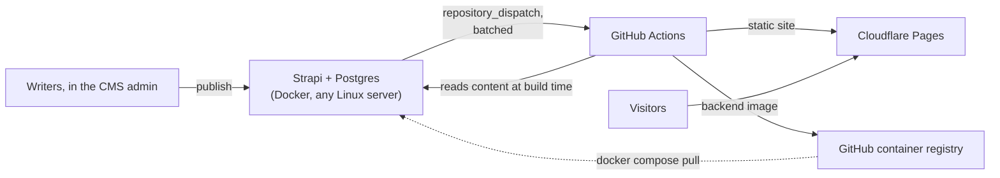

# Far Enough: a travellers' blog

Técnico Solar Boat, Autonomous Systems recruitment, Phase 2: Web Development & Infrastructure.

A statically built, bilingual blog in Astro and Tailwind CSS. Its content is managed without
code in a Strapi CMS, and publishing there rebuilds and redeploys the site automatically.



The design decisions and their trade-offs are in [REPORT.md](REPORT.md).

| Path | Contents |
| --- | --- |
| `frontend/` | Astro site: pages in `src/pages/[...locale]`, content access in `src/lib/cms.ts` |
| `backend/` | Strapi: content types in `src/api`, roles and rebuild trigger in `src/bootstrap` |
| `backend/seed/` | Demo content and artwork, used to seed the CMS and for pull request builds |
| `.github/workflows/` | The frontend and backend pipelines |
| `docker-compose.yml` | Production backend: Strapi, Postgres and their volumes |
| `scripts/` | Secrets generation, image smoke test, branch protection |

## Requirements

Node.js 22 (the frontend needs 22.23.4 or newer) and Docker with the Compose plugin.

## Run in development

Backend, at <http://localhost:1337/admin>:

```bash
cd backend
cp .env.example .env
npm ci
npm run build
npm run seed        # optional demo content
npm run develop
```

The first visit to the admin panel asks you to create the Admin account.

Frontend, at <http://localhost:4321>:

```bash
cd frontend
cp .env.example .env
npm ci
STRAPI_URL=http://localhost:1337 npm run dev
```

With no `STRAPI_URL`, the site is built from the demo content in `backend/seed`, so the
frontend can also be worked on with no backend running. Pages read the CMS once per server
start in this mode, so restart `npm run dev` to see new content.

## Run in production mode on a local machine

The backend, with Postgres, using the production image:

```bash
scripts/generate-env.sh
docker build -t tsb-backend backend
BACKEND_IMAGE=tsb-backend docker compose up -d --no-build
docker compose exec backend npm run seed     # optional demo content
```

The static site, built from that backend:

```bash
cd frontend
npm ci
STRAPI_URL=http://localhost:1337 npm run build
npm run preview
```

## Deploy to production

### 1. Backend, on a Linux server

Copy `docker-compose.yml` and `scripts/generate-env.sh` to the server (keeping the `scripts/`
folder), then:

```bash
scripts/generate-env.sh
docker compose pull
docker compose up -d
```

Put HTTPS in front of port 1337 with a reverse proxy or a tunnel, and create the Admin account
at `https://your-cms-address/admin`. To update, run `docker compose pull && docker compose up -d`.

All state is in two Docker volumes: `postgres-data` and `uploads`. Back these up. Containers
can be recreated freely, and `docker compose down` keeps the volumes, but `down -v` deletes them.

If the registry package is private, run `docker login ghcr.io` on the server first.

### 2. Frontend, on Cloudflare Pages

Create the Pages project once:

```bash
npx wrangler pages project create far-enough --production-branch=main
```

Then set these in the GitHub repository, under Settings, Secrets and variables, Actions:

| Kind | Name | Value |
| --- | --- | --- |
| Secret | `CLOUDFLARE_API_TOKEN` | A token with the *Cloudflare Pages: Edit* permission |
| Secret | `CLOUDFLARE_ACCOUNT_ID` | Your Cloudflare account ID |
| Variable | `CLOUDFLARE_PROJECT` | `far-enough` |
| Variable | `STRAPI_URL` | The public address of the CMS, reachable from GitHub |
| Variable | `SITE_URL` | The public address of the site |

Each push to `main` now tests and deploys the site.

### 3. Connect publishing to rebuilds

Create a fine-grained GitHub token with *Contents: Read and write* on this repository only.
Add it to the server's `.env`, and restart with `docker compose up -d`:

```bash
GITHUB_DISPATCH_REPO=owner/repository
GITHUB_DISPATCH_TOKEN=the-token
```

Publishing, unpublishing or deleting content now rebuilds the site, within about a minute of
the first change plus the time the pipeline takes. Changes in that minute share one rebuild.

### 4. Require the checks before merging

```bash
scripts/protect-main.sh owner/repository
```

GitHub only enforces this on public repositories, unless the account has a paid plan.

## Pipelines

| Workflow | Runs on | What it does |
| --- | --- | --- |
| Frontend | Push to `main`, pull request, CMS publish | Type-checks, builds and tests the site. Deploys to Cloudflare Pages, except on pull requests |
| Backend | Push to `main`, pull request | Builds, tests roles and API on a real server, builds the image and starts it. On `main`, publishes it to `ghcr.io` |

## Users and roles

Roles are created automatically. The Admin invites people under Settings, Users, and picks one:

| Role | Articles | Gallery | Team and tags | Backend settings |
| --- | --- | --- | --- | --- |
| Writer | Own only | None | Read; can add tags | No |
| Traveller | Own only | Own only | Read; can add tags | No |
| Moderator | Everyone's | Everyone's | Full | No |
| Admin | Everyone's | Everyone's | Full | Yes |

## Tests

```bash
cd backend && npm run build && npm test    # roles, public API, rebuild trigger
cd frontend && npm run build && npm test   # the finished site
```
